<h1 align="center">GENESIS-OMEGA</h1>
<h3 align="center">THE UNIVERSE ENGINE</h3>

<i>In the beginning there was gravity. Now there is code.</i>

## ☄️ BEHOLD

Two galaxies. Sixty thousand suns. Two supermassive black holes falling toward each other across the dark.
They collide. Stars are hurled into tidal tails millions of light-years long. The black holes spiral in, and become **one**.

All of it live, in your browser, in the palm of your hand.

> OpenESIS-OMEGA"></

## 🎮 YOU ARE THE CREATOR

| Gesture | Act of God |
|---|---|
|GA</h1>
<| Hurl a new galaxy into the void |
|nner.svg" | Rotate the heavens |
|rc="assets/| Dive into the core |
|rc="assets/bann| Two galaxies, one fate |
|assets/banne| Three galaxies, one dance |
|ets/banner.svg| Rewind to the first second |

## 🧠 THE FORGE

-th="100%" alt="GENESIS- black holes pull on each other by direct summation and merge on contact; every star is a test particle in their softened gravity.
-n="center">THE UNIVERSE ENG orbits hold for thousands of revolutions.
-g" width="100%" alt="GE stars burned straight into assets/banner.sv composited on the GPU with trails and bloom.
-width="100%" alt="GENE the engine tunes itself to your device.

## 🛰️ THE ROAD TO INFINITY

- [ ] Barnes-Hut: every star pulls on every star
- [ ] WebGPU compute:img src="assets/stats.- [ ] Dark matter halos, gas, the birth of new stars
- [ ] Multiplayer universes

<b>MIT License. Build worlds.</b>

